# TIMELINE & PHÂN CÔNG CÔNG VIỆC — NHÓM 4 NGƯỜI

> **Dự án:** Lab 13 — Định giá agent và lập kế hoạch pilot (LogiX-VN, Gate 2a)  
> **Lớp / Nhóm:** `L3A` · `PhanDao` (`K5-L3A-DAY13-PhanDao-LaunchEconomics`)  
> **Hình thức:** Nhóm 4 người · **Tại lớp:** 14:00–18:00 (Hồ sơ phải sẵn sàng lúc **17:00** để duyệt chéo) · **Hạn nộp LMS:** trước **23:59 GMT+7** cùng ngày

---

## 1. Tổng quan sản phẩm & Cơ cấu điểm (100 điểm)

Toàn bộ nhóm phải trả lời 4 câu hỏi cốt lõi cho trợ lý hoàn phí LogiX-VN trên bộ dữ liệu giả lập (`1.200` yêu cầu, `1.624` lần chạy):
1. **Có đáng chạy không?** (Chi phí mỗi việc thành công, so sánh với nhân viên tự làm 12.000 đ).
2. **Nhân viên có dùng không?** (Chỉ số sử dụng và danh sách event có `trace_id`).
3. **Khi hỏng thì sao?** (Phân loại 20 ca lỗi theo Google PAIR và bảng khắc phục 5 ca).
4. **Pilot thiết kế thế nào để ra quyết định?** (Có nhóm đối chứng, đủ cỡ mẫu, có luật dừng).

| Khối chấm | Nhiệm vụ / Tiêu chí | Điểm | File bằng chứng chính |
|---|---|---:|---|
| **Đối chiếu đáp án (70đ)** | **C1 · Nhiệm vụ A (CP1):** Mô hình chi phí | 20 | `src/lab13.py`, `report/team/bang_chi_phi.md` |
| *(Trợ giảng chấm, sai số ≤ 2%)* | **C2 · Nhiệm vụ B (CP2):** Bảng độ nhạy | 15 | `src/lab13.py`, `report/team/bang_chi_phi.md` |
| | **C3 · Nhiệm vụ C (CP3):** Bảng lỗi & khắc phục | 10 | `report/team/bang_loi.md` |
| | **C4 · Nhiệm vụ D (CP4):** Kế hoạch pilot | 15 | `src/lab13.py` (D1), `report/team/pilot_plan.yaml` |
| | **C5 · Nhiệm vụ E (CP5):** Chỉ số, event, rủi ro, hồ sơ | 10 | `report/team/chi_so.md`, `report/team/ho_so_launch_v0.md` |
| **Hội đồng Gate 2a (30đ)** | **C6:** Đề xuất khớp bằng chứng (nêu cả số bất lợi) | 10 | `report/team/ho_so_launch_v0.md`, `report/team/phieu_cham.md` |
| *(Nhóm hội đồng chấm)* | **C7:** Nhãn `simulated` & thu hẹp phạm vi có số | 10 | Toàn bộ `report/team/` |
| | **C8:** Pilot tách tác động, đủ mẫu, luật dừng đủ 4 vế | 10 | `report/team/pilot_plan.yaml` |
| **Thủ tục & Báo cáo** | Thông tin nhóm & đóng góp cá nhân *(bắt buộc)* | — | `TEAM.md`, `report/team/group_report.md`, `report/team/<MSSV>_<HoTen>.md` (4 file) |

---

## 2. Phân công 4 vai trò & Quyền sở hữu file

Theo `TEAM.md` và `CHECKPOINTS.md`, nhóm chia 4 vai chính thức và **đổi người viết code sau giờ giải lao (15:35)** để ít nhất 2 thành viên tự tay tính được chi phí và chạy code.

> **Điền nhanh đầu buổi (14:00):**
> - **TV1 (Người viết code GĐ1):** `Họ tên - MSSV`
> - **TV2 (Người kiểm số & Người viết code GĐ2):** `Họ tên - MSSV`
> - **TV3 (Người gắn nhãn 1 & QA / Spec):** `Họ tên - MSSV`
> - **TV4 (Người gắn nhãn 2 kiêm Giữ hồ sơ / PM):** `Họ tên - MSSV`

### Ma trận trách nhiệm theo file (tránh xung đột Git)

| File | Chủ biên (Primary) | Kiểm tra / Hỗ trợ | Ghi chú bắt buộc |
|---|---|---|---|
| `src/lab13.py` | **TV1** (CP1–CP2) → **TV2** (CP4–CP5) | TV2 kiểm tra CP1–CP2; TV1 hỗ trợ CP4 | Bắt buộc chạy hết trên **2 máy khác nhau** |
| `report/team/bang_chi_phi.md` | **TV2** | **TV1** cấp output từ `lab13.py` | Ghi nhãn `simulated` ở số giả lập; câu trả lời ≤ 3 dòng, có số |
| `report/team/bang_loi.md` | **TV4** | **TV3** & **TV4** gắn độc lập 20 ca | Không sửa bộ nhãn độc lập sau khi đã so |
| `report/team/pilot_plan.yaml` | **TV1** (điền YAML) + **TV2** (số D1) | **TV3**, **TV4** chốt luật dừng & D2 | Không còn dấu `?` ngoài comment; pass `yaml.safe_load` |
| `report/team/chi_so.md` | **TV3** | **TV2** (tính thử E1), **TV1** (chốt event) | E2 lấy số trực tiếp từ `bang_chi_phi.md` |
| `report/team/ho_so_launch_v0.md` | **TV4** *(điền dần từ đầu buổi)* | Cả nhóm chốt đề xuất lúc 16:50 | Đúng 1 trang, 7 mục, 17:00 gửi hội đồng |
| `report/team/phieu_cham.md` | **TV3** | Cả nhóm thảo luận chấm chéo Gate 2a | Chấm nhóm `n + 1` theo bằng chứng |
| `report/team/group_report.md` | **TV4** | **TV1, TV2, TV3** điền kết quả phần mình | Tối đa 2 trang, dẫn lại số chính |
| `TEAM.md` | **TV4** (khung chung) | Mỗi thành viên tự bổ sung mục cá nhân | Ghi rõ vai, đóng góp, bằng chứng commit/file |
| `report/team/<MSSV>_<HoTen>.md` | **Mỗi người tự viết file riêng** | Copy từ `MSSV_HoTen.md` | **Không xóa/sửa file mẫu `MSSV_HoTen.md`** |

> [!CAUTION]
> **Các file TUYỆT ĐỐI KHÔNG SỬA:**
> - `src/lab13_starter.py` (bản gốc đối chiếu)
> - `src/logix_runs.csv` và `src/logix_requests.csv`
> - `report/team/MSSV_HoTen.md` (giữ nguyên làm file mẫu; mỗi người copy thành file mới)

---

## 3. Luồng phối hợp song song 4 người

```mermaid
flowchart LR
    S["14:00 Setup<br/>4 máy clone & 2+ máy cài venv"] --> CP1["14:10 CP1 · A1-A4<br/>TV1 code | TV2 tính tay<br/>TV3 rà đề | TV4 mở hồ sơ"]
    CP1 --> CP2["14:53 CP2 · B1-B4<br/>TV1 code | TV2 điền bảng<br/>TV3 rà B3/B4 | TV4 cập nhật Mục 2"]
    CP2 --> BRK["15:20 Giải lao<br/>Chuyển quyền Coder: TV1 -> TV2"]
    BRK --> CP3_P1["15:35 CP3 (8 phút đầu)<br/>TV3 & TV4: gắn độc lập 20 ca<br/>TV1 & TV2: chốt nốt B + test máy 2"]
    CP3_P1 --> CP3_P2["15:43 CP3 (22 phút sau)<br/>So nhãn (>=80%), chốt quy tắc<br/>Cả nhóm điền bảng 5 ca"]
    CP3_P2 --> CP4["16:08 CP4 · D1-D3<br/>TV2 code D1 | TV1 viết YAML<br/>TV3 kiểm D2 | TV4 chốt Stop rules"]
    CP4 --> CP5["16:36 CP5 · E1-E3<br/>TV3 viết chi_so.md | TV2 tính E1<br/>TV1 rà event | TV4 chốt ho_so_launch_v0.md"]
    CP5 --> GATE["17:00 Duyệt chéo Gate 2a<br/>TV1 & TV2: trình/đáp phản biện<br/>TV3 & TV4: chấm nhóm n+1"]
    GATE --> PACK["17:45 Đóng gói & Push<br/>Kiểm tra máy 2, checklist, LMS <23:59"]
```



---

## 4. Timeline chi tiết theo từng chặng

### Chặng 0 · Khởi động, phân vai & cài môi trường (`14:00 – 14:10` · 10 phút)

| Thành viên | Việc cần làm ngay |
|---|---|
| **TV1 (Coder GĐ1)** | Cài `.venv` trong `src/`, cài `requirements.txt`, chạy thử `python lab13.py` (xác nhận lỗi `NotImplementedError` đúng khung) và đọc trước đoạn code `A1` trong `docs/Lab13_Huong_dan_chi_tiet_buoi_chieu.md`. |
| **TV2 (Kiểm số)** | Cài `.venv` trên **máy thứ hai** (`python -c "import pandas, numpy, scipy, statsmodels, yaml; print('san sang')"`), đọc bảng giá & 6 công thức trong `docs/du_lieu_va_cong_thuc.md`. |
| **TV3 (Gắn nhãn 1 / QA)** | Mở `CHECKPOINTS.md` và `RUBRIC.md`, tạo danh sách kiểm tra nhanh các điều kiện "Xong khi" và đọc bảng `chi_so.md` để nắm trước cấu trúc E1. |
| **TV4 (Gắn nhãn 2 / Giữ hồ sơ)** | Điền thông tin nhóm (`L3A`, `PhanDao`, URL repo `K5-L3A-DAY13-PhanDao-LaunchEconomics`, bảng 4 thành viên) vào `TEAM.md` và phần đầu `report/team/ho_so_launch_v0.md`. |

- **Mốc xong (14:10):** Ít nhất **2 máy** chạy được môi trường Python; mọi người đã clone đúng repo nhóm `PhanDao`.

---

### Chặng 1 · CP1 — Nhiệm vụ A: Mô hình chi phí mỗi việc thành công (`14:10 – 14:53` · 40 phút làm + 3 phút chữa · **20 điểm**)

| Thời gian | TV1 (Coder GĐ1) | TV2 (Kiểm số) | TV3 (Gắn nhãn 1 / QA) | TV4 (Giữ hồ sơ) |
|---|---|---|---|---|
| **14:10 – 14:20** *(10p)* | Viết 3 hàm **A1** trong `src/lab13.py`; chạy tới khi in `Ba phép thử đáp án biết trước: ĐẠT` (`1,20 · 1,25 · 1,25`). | Tính tay kiểm chứng lại 3 phép thử A1; điền bảng **A1** vào `report/team/bang_chi_phi.md`. | Kiểm tra điều kiện dừng A1: chưa đạt 3/3 thì **không cho qua A2**. | Khởi tạo khung 7 mục trong `ho_so_launch_v0.md`, ghi sẵn tên vai trò phụ trách từng mục. |
| **14:20 – 14:40** *(20p)* | Viết `mo_hinh(runs, reqs, ...)` (**A2**) có đủ tham số mặc định cho B (`gia_vao`, `gia_ra`, `gia_tool`, `luong_phut`, `he_so_xem_lai`, `he_so_lam_lai`, `max_lan_chay`). Đảm bảo đọc CSV có `keep_default_na=False`. | Chọn ngẫu nhiên 1–2 dòng hoặc tổng cộng trên CSV tính tay đối chiếu tiền token/tool (`token` phải chia `1.000`). Điền bảng **A2** (9 dòng) vào `bang_chi_phi.md`. | Rà lỗi hay gặp: tử số tính **mọi** lần chạy (kể cả lỗi), mẫu số chỉ đếm `ket_qua == 'thanh_cong'`; kiểm tra gắn nhãn `simulated`. | Ghi trước các câu trả lời A2 (gấp bao nhiêu lần hoá đơn; khoản nào lớn nhất %) ≤ 3 dòng, có số. |
| **14:40 – 14:50** *(10p)* | Chạy **A3** (lặp theo 4 giá trị cột `loai`) + in tỉ lệ `status == 'ok'` theo từng `attempt` và `loai`. Tính thêm **A4** (cố định 40 triệu/tháng cho `noi_dia + hang_nang`). | Điền bảng **A3** (4 dòng) và **A4** (2 mức khối lượng) vào `bang_chi_phi.md`; tính lại tổng hệ thống khi cộng phần chuyển nhân viên (`× 12.000 đ`). | Đối chiếu câu trả lời A3: `quoc_te` không đáng chạy và chạy lại 3 lần có giúp không (dựa vào tỉ lệ thành công và số lần chạy/yc). | Điền **Mục 1** (Chi phí/việc thành công, nhãn `Giả lập`) và **Mục 3** (So với 12.000 đ, nhãn `Giả lập`) vào `ho_so_launch_v0.md`. |
| **14:50 – 14:53** *(3p)* | **Chữa bài trên slide:** Đối chiếu mọi con số A1–A4 (phải lệch ≤ 2%). Nếu lệch > 2%, sửa ngay tại chỗ vì CP2 dùng lại `mo_hinh`. Commit `cp1`. | | | |

- **Mốc xong CP1:** `python lab13.py` in `ĐẠT` + bảng A2, A3, A4; `bang_chi_phi.md` đủ phần A; `ho_so_launch_v0.md` xong Mục 1 & 3.

---

### Chặng 2 · CP2 — Nhiệm vụ B: Bảng độ nhạy (`14:53 – 15:20` · 25 phút làm + 2 phút chữa · **15 điểm**)

| Thời gian | TV1 (Coder GĐ1) | TV2 (Kiểm số) | TV3 (Gắn nhãn 1 / QA) | TV4 (Giữ hồ sơ) |
|---|---|---|---|---|
| **14:53 – 15:05** *(12p)* | Code vòng lặp **B1** gọi `mo_hinh` cho 9 kịch bản (`TODO CP2`), lưu ý xử lý đúng `max_lan_chay` (`attempt <= max`, `so_lan_chay > max` coi là `chuyen_nhan_vien`, phút simulated = 0). | Kiểm tra quy luật tuyến tính: mỗi kịch bản "giảm một nửa" phải giảm đúng bằng nửa mức tăng của kịch bản "gấp đôi". Điền 9 dòng **B1** vào `bang_chi_phi.md`. | Chuẩn bị trước phần đọc đề **Nhiệm vụ C** (hiểu rõ 5 định nghĩa lỗi Google PAIR) để 15:35 vào việc ngay. | Ghi chú 3 yếu tố nhạy nhất dự kiến vào nháp `ho_so_launch_v0.md`. |
| **15:05 – 15:18** *(13p)* | Chạy **B2** (đổi cặp token ×2 & xem lại ×2), **B3** (chi phí cả hệ thống ở giới hạn 1, 2, 3 lần chạy), **B4** (xem lại 100% cho `noi_dia + hang_nang` với 9 phút làm lại và độ nhạy 15,3 phút thực tế). | Điền **B2** (xếp hạng top 3 yếu tố), bảng **B3** và câu trả lời **B3, B4** vào `bang_chi_phi.md` (≤ 3 dòng/câu, có đủ số). | Kiểm tra xem B3 có phân biệt được "tối ưu chi phí/việc thành công (1 lần)" vs "rẻ nhất cả hệ thống (2 lần)" không. | Cập nhật **Mục 2** (3 yếu tố nhạy nhất, nhãn `Giả lập`) vào `ho_so_launch_v0.md`. |
| **15:18 – 15:20** *(2p)* | **Chữa bài trên slide:** Đối chiếu B1–B4 (lệch ≤ 2%). Phần nào chưa gõ kịp vào markdown sẽ hoàn thiện trong 8 phút đầu CP3. | | | |

---

### Giải lao & Bàn giao quyền Coder (`15:20 – 15:35` · 15 phút)

- Nghỉ giải lao tại chỗ; **TV1** commit/push code hết CP2 (`git commit -m "cp1-cp2: cost model and sensitivity"`).
- **TV2** `git pull` về máy mình để chuẩn bị **tiếp nhận vai trò Người viết code từ CP3/CP4 trở đi** (đúng yêu cầu trong `TEAM.md`).

---

### Chặng 3 · CP3 — Nhiệm vụ C: Bảng lỗi & Cách khắc phục (`15:35 – 16:08` · 30 phút làm + 3 phút chữa · **10 điểm**)

> [!IMPORTANT]
> **Quy tắc liêm chính bắt buộc:** Trong 8 phút đầu, TV3 và TV4 **ngồi tách nhau, gắn độc lập 20 ca lỗi, tuyệt đối không trao đổi** và **không sửa bộ nhãn độc lập sau khi đã so**.

| Thời gian | TV1 (Hỗ trợ / Kiểm số) | TV2 (Coder GĐ2) | TV3 (Gắn nhãn 1) | TV4 (Gắn nhãn 2 / Hồ sơ) |
|---|---|---|---|---|
| **15:35 – 15:43** *(8p)* | Rà soát lại toàn bộ số liệu và câu trả lời A1–B4 trong `report/team/bang_chi_phi.md` (nhãn `simulated`, độ dài ≤ 3 dòng). | Kéo code mới nhất, chạy lại `src/lab13.py` trên máy 2 để xác nhận khớp 100%, chuẩn bị khung code **D1**. | **Gắn nhãn độc lập 20 ca lỗi** (trong `docs/Ngay13_Lab13_De_bai_hoc_vien.docx`) vào bản ghi riêng theo 5 loại Google PAIR (gắn theo **nguyên nhân gốc**). | **Gắn nhãn độc lập 20 ca lỗi** (ngồi tách TV3, không trao đổi) theo 5 loại Google PAIR. |
| **15:43 – 15:46** *(3p)* | Hỗ trợ ghi nhận thống kê tỉ lệ đồng thuận. | Hoàn tất dọn sạch format `bang_chi_phi.md`. | **So nhãn với TV4**, đếm số ca trùng và tính `đồng thuận = số ca trùng / 20` (mục tiêu ≥ 80% tức ≥ 16/20). | Nhập cả 2 bộ nhãn độc lập vào `report/team/bang_loi.md`. |
| **15:46 – 15:51** *(5p)* | **Cả nhóm** tranh luận nhanh các ca không trùng, thống nhất nhãn chung và viết **1 câu quy tắc phân biệt** cho từng ca lệch (nếu đồng thuận < 80% phải sửa lại định nghĩa 5 loại). | | | |
| **15:51 – 16:05** *(14p)* | Đề xuất cách phát hiện đo được (tên event, ngưỡng, tần suất) cho ca **Hệ thống** & **Giới hạn**. | Đề xuất cách phát hiện cho ca **Ngầm** (audit mẫu) & **Do người dùng**. | Chọn 5 ca (mỗi loại 1 ca), rà đảm bảo cột "Ai phụ trách" ghi **1 vai trò cụ thể** (VD: Kỹ sư trưởng agent, PM trợ lý hoàn phí, Trưởng nhóm CSKH, Kế toán trưởng), **không ghi "cả đội"**. | Hoàn thiện bảng khắc phục 5 ca trong `report/team/bang_loi.md` và cập nhật **Mục 5** vào `ho_so_launch_v0.md`. |
| **16:05 – 16:08** *(3p)* | **Chữa bài trên slide:** Đối chiếu đáp án 20 ca (yêu cầu khớp đáp án ≥ 16/20 ca). Commit `cp3`. | | | |

---

### Chặng 4 · CP4 — Nhiệm vụ D: `pilot_plan.yaml` (`16:08 – 16:36` · 25 phút làm + 3 phút chữa · **15 điểm**)

| Thời gian | TV1 (Hỗ trợ YAML / Code) | TV2 (Coder GĐ2) | TV3 (Gắn nhãn 1 / QA) | TV4 (Giữ hồ sơ) |
|---|---|---|---|---|
| **16:08 – 16:20** *(12p)* | Tính tay câu **e** (mức chênh 6 điểm với 20 người/nhóm → `m ≥ 299`, `DE = 6,96`) và kiểm tra power thực nếu tác động thật chỉ 5 điểm (`NormalIndPower`, ~0,64). | Code mục **D1** ở `TODO CP4` trong `src/lab13.py` (tính 5 câu **a, b, c, d, e**) + tính tỉ lệ `mo_lai_trong_7_ngay` hiện tại trên toàn mẫu & trong phạm vi `noi_dia + hang_nang`. | Tổng hợp các câu trả lời **D2** (5 câu kiểm tra "tách được tác động": đối chứng cùng thời gian, ngẫu nhiên phân tầng depot, giảm spillover, viết trước, ≥ 20 cụm/nhóm). | Soạn thảo khung giải trình **đánh đổi** (vì 40 nhân viên không đủ 1.251 mẫu ở MDE 5 điểm, buộc chọn 20+20 nhân viên ở MDE 6 điểm). |
| **16:20 – 16:25** *(5p)* | **Cả nhóm** thống nhất phương án chia cụm theo nhân viên (`20 + 20`, `mde = 0.06`) và chốt ngưỡng luật dừng (so với tỉ lệ mở lại hiện tại ~4,25% để tránh dừng nhầm tuần 1). | | | |
| **16:25 – 16:33** *(8p)* | Điền toàn bộ các trường của `report/team/pilot_plan.yaml` (`owner`, `scope`, `assignment`, `primary_metric`, `identifiability`, `rollback`, `decision_date`, `simulated_inputs`) và ghi kết quả D1, D2 vào phần comment `#` đầu file. | Chạy kiểm tra cú pháp YAML (`yaml.safe_load`) và lệnh tìm dấu `?` còn sót ngoài comment. | Soạn & kiểm tra **ít nhất 3 luật dừng** (An toàn, Chi phí, Sử dụng) đúng 4 vế: `NẾU ... TRONG ... THÌ ... KHÔNG THÌ ...`, có ngưỡng + thời hạn + 1 vai trò có quyền dừng. | Cập nhật **Mục 6** (Pilot plan, trạng thái `Xong, có bằng chứng`) vào `report/team/ho_so_launch_v0.md`. |
| **16:33 – 16:36** *(3p)* | **Chữa bài trên slide:** Đối chiếu 5 số D1 (≤ 2%) và cấu trúc `pilot_plan.yaml`. Commit `cp4`. | | | |

---

### Chặng 5 · CP5 — Nhiệm vụ E: Chỉ số, Rủi ro kinh tế & Hồ sơ Launch v0 (`16:36 – 17:00` · 20 phút làm + 4 phút chữa · **10 điểm**)

| Thời gian | TV1 (Event & Đối chiếu) | TV2 (Coder GĐ2) | TV3 (Chủ trì `chi_so.md`) | TV4 (Chủ trì `ho_so_launch_v0.md`) |
|---|---|---|---|---|
| **16:36 – 16:44** *(8p)* | Liệt kê **tối thiểu 6 event** (khuyến nghị 8–10 event đủ luồng) có `trace_id`, ai tạo, thuộc tính chính, thời điểm; kiểm tra chéo mỗi chỉ số tính từ event nào. | Thêm đoạn code tính 3 chỉ số **E1** trên 1.200 yêu cầu (`chinh`, `bo_qua`, `an_toan`) vào `src/lab13.py` và in ra đối chiếu. | Điền bảng **E1** trong `report/team/chi_so.md` (3 chỉ số tính thử + tự đề xuất thêm **1 chỉ số dùng** & **1 chỉ số an toàn**); đảm bảo viết *"chỉ số trong đợt chạy thử là…"*, không viết *"đã nâng"*. | Cập nhật **Mục 4** (Chỉ số chính, dùng, an toàn) vào `ho_so_launch_v0.md`. |
| **16:44 – 16:48** *(4p)* | Kiểm tra khớp số giữa `bang_chi_phi.md` và bảng rủi ro. | Lấy số trực tiếp từ bảng độ nhạy B1/B4/A4 để điền bảng **E2 · Rủi ro kinh tế** (≥ 2 dòng, khuyến nghị 3 dòng). | Hoàn thiện định dạng `report/team/chi_so.md`, gán người phụ trách là 1 vai trò cụ thể cho từng rủi ro. | Cập nhật **Mục 7** (Rủi ro kinh tế, nhãn `Giả lập`) vào `ho_so_launch_v0.md`. |
| **16:48 – 16:56** *(8p)* | **Cả nhóm** rà 7 mục trên 1 trang `ho_so_launch_v0.md` và **chốt đề xuất cuối**: `Go` / `Go có điều kiện` / `No-go` (nếu `Go có điều kiện`: ghi rõ từng điều kiện, người phụ trách và ngày kiểm tra; nêu cả con số bất lợi như xem lại 100% đắt bằng 0,98×–1,03× hoặc power 0,64 ở MDE 5 điểm). | | | Hoàn thiện `ho_so_launch_v0.md` gọn trong **1 trang**; chạy lệnh rà soát không có từ bị cấm (`production`). |
| **16:56 – 17:00** *(4p)* | **Chữa bài trên slide & Gửi hồ sơ:** Đối chiếu 3 chỉ số E1; gửi `report/team/ho_so_launch_v0.md` cho nhóm hội đồng chấm chéo đúng **17:00**. Commit `cp5`. | | | |

---

### Chặng 6 · Duyệt chéo Gate 2a (`17:00 – 17:45` · 45 phút · **30 điểm hội đồng**)

| Thời gian | Hoạt động chung | TV1 & TV2 (Đại diện đội trình bày) | TV3 & TV4 (Đại diện hội đồng chấm nhóm `n+1`) |
|---|---|---|---|
| **17:00 – 17:10** *(10p)* | Chốt link/file gửi hồ sơ sang nhóm bạn và nhận hồ sơ nhóm `n+1`. | Chuẩn bị kịch bản trình bày **đúng 1 phút** (tập trung 4 câu hỏi + con số bất lợi + điều kiện Go). | Đọc lướt hồ sơ nhóm `n+1` và mở sẵn `report/team/phieu_cham.md`. |
| **17:10 – 17:25** *(15p)* | Đọc kỹ & chuẩn bị phản biện. | Dự phòng trả lời các câu hỏi bẫy (xem lại 100%, 20 cụm, ngưỡng an toàn 4,25%, power 0,64, ý nghĩa tử/mẫu số). | Chấm 3 tiêu chí (0 / 5 / 10 điểm) vào `phieu_cham.md` dựa hoàn toàn vào **bằng chứng số**, viết quyết định + 1 câu hỏi sắc bén. |
| **17:25 – 17:40** *(15p)* | 5 cặp trình bày (3 phút/cặp: 1p trình + 1p công bố + 1p hỏi đáp). | **TV1** trình bày 1 phút; **TV2** trả lời câu hỏi phản biện từ hội đồng. | **TV3** công bố điểm/quyết định & đặt câu hỏi; **TV4** ghi lại câu trả lời của đội trình vào `phieu_cham.md`. |
| **17:40 – 17:45** *(5p)* | Giảng viên chốt quyết định nào khớp bằng chứng. | Ghi nhận góp ý của giảng viên & hội đồng để cập nhật vào mục 4 & mục 7 của `group_report.md`. | Lưu và commit `report/team/phieu_cham.md`. |

---

### Chặng 7 · Đóng gói, Kiểm tra chéo & Push GitHub (`17:45 – 18:00` · 15 phút)

| Thành viên | Việc đóng gói cuối buổi |
|---|---|
| **TV1** | Kiểm tra `src/lab13.py` sạch sẽ, không hardcode sai đường dẫn, không sửa `lab13_starter.py` hay 2 file CSV; tự viết phần đóng góp trong `TEAM.md` và tạo `report/team/<MSSV>_<HoTen>.md`. |
| **TV2** | **Chạy kiểm tra toàn bộ `src/lab13.py` và `pilot_plan.yaml` trên máy thứ hai** (khác máy TV1); xác nhận không lỗi; tự viết `TEAM.md` và `report/team/<MSSV>_<HoTen>.md`. |
| **TV3** | Chạy checklist rà soát toàn bộ `report/team/`: nhãn `simulated`, không còn dấu `?` trong YAML, không ghi "cả đội", không có từ "production"; tự viết `TEAM.md` và `report/team/<MSSV>_<HoTen>.md`. |
| **TV4** | Tổng hợp `report/team/group_report.md` (≤ 2 trang, đủ 8 mục theo mẫu); rà soát đủ 6 file hồ sơ + `group_report.md` + 4 file cá nhân + giữ nguyên `MSSV_HoTen.md`; commit & push toàn bộ lên nhánh `main`. |

---

### Chặng 8 · Hậu kiểm & Nộp bài cá nhân trên LMS (`18:00 – 23:59 GMT+7`)

- **18:00 – 22:00 (nếu cần trau chuốt thêm):** Nếu tại lớp chưa kịp hoàn chỉnh `group_report.md` hoặc 4 file báo cáo cá nhân `report/team/<MSSV>_<HoTen>.md`, tạo **commit mới** (tuyệt đối **không** `git push --force`, xóa commit hay sửa timestamp theo `RULES.md`), điền thông tin commit chốt vào `TEAM.md`.
- **Trước 23:59 GMT+7 (Bắt buộc với TẤT CẢ 4 người):**
  - Kiểm tra repo `https://github.com/LysLama/K5-L3A-DAY13-PhanDao-LaunchEconomics` đang ở chế độ **Public** (hoặc đã mời giảng viên).
  - **Cả 4 thành viên tự đăng nhập tài khoản LMS cá nhân và nộp cùng một link repo nhóm.** *(Theo `SUBMISSION.md`: ai không tự nộp link trên LMS sẽ không có điểm dù nhóm đã push).*

---

## 5. Quy tắc phối hợp Git để tránh xung đột (Conflict-Free)

1. **Mỗi file một chủ biên trong cùng khung giờ:** Không 2 người cùng sửa một file markdown cùng lúc (đặc biệt là `ho_so_launch_v0.md` chỉ giao **TV4** cập nhật; mọi người gửi số qua chat nhóm hoặc điền file mình phụ trách).
2. **Pull trước khi sửa & Push:** Trước mỗi mốc chữa slide (`14:53`, `15:20`, `16:08`, `16:36`, `17:00`, `17:45`), chạy `git pull --rebase origin main` trước khi push phần của mình.
3. **Báo cáo cá nhân độc lập:** 4 file `report/team/<MSSV>_<HoTen>.md` khác tên nhau hoàn toàn nên có thể viết và push bất kỳ lúc nào mà không bao giờ conflict.
4. **Không commit file rác:** `.gitignore` đã chặn `.venv/`, `.env`, `__pycache__/`, `example/`; kiểm tra `git status` trước mọi lần `git add`.

---

## 6. Năm quy tắc vàng & Lệnh tự kiểm tra trước khi chốt nộp

### Năm quy tắc bắt buộc của Lab 13
1. Đạt đủ **3 phép thử A1** (`1,20 · 1,25 · 1,25`) trước khi sang A2.
2. Mọi con số tính từ cột `_simulated` phải gắn nhãn **`simulated`** (hoặc `Giả lập` ở cột Trạng thái).
3. Đối chiếu ngay khi slide chữa hiện lên (sai số tối đa `≤ 2%`).
4. Mỗi câu trả lời giải thích **không quá 3 dòng**, có **ít nhất 1 con số**.
5. **Không dùng từ `"production"`** trong bất kỳ file hồ sơ nào (Gate 2a chỉ duyệt kế hoạch pilot).

### Bộ lệnh kiểm tra nhanh (chạy trong PowerShell tại thư mục gốc repo)

```powershell
# 1. Kiểm tra chạy full pipeline trên máy thứ 2 (A1, A2, A3, B, D1, E1)
cd src
.\.venv\Scripts\python.exe lab13.py

# 2. Kiểm tra pilot_plan.yaml đọc được và không còn dấu '?' ngoài dòng comment '#'
.\.venv\Scripts\python.exe -c "import yaml; d = yaml.safe_load(open('../report/team/pilot_plan.yaml', encoding='utf-8')); print('YAML OK:', list(d['pilot'].keys()))"
Select-String -Path ..\report\team\pilot_plan.yaml -Pattern '\?' | Where-Object { $_.Line -notmatch '^\s*#' }

# 3. Kiểm tra không có từ 'production' trong toàn bộ hồ sơ report/team/
Select-String -Path ..\report\team\* -Pattern 'production' -CaseSensitive:$false

# 4. Kiểm tra các file dữ liệu gốc và starter KHÔNG bị sửa đổi
cd ..
git diff --stat src/lab13_starter.py src/logix_runs.csv src/logix_requests.csv report/team/MSSV_HoTen.md
```

### Checklist cuối cùng trước 23:59 GMT+7

- [ ] `TEAM.md` điền đủ thông tin nhóm `PhanDao`, lớp `L3A`, 4 thành viên, vai trò và đóng góp.
- [ ] Có đủ 4 file báo cáo cá nhân `report/team/<MSSV>_<HoTen>.md` (và vẫn giữ nguyên file mẫu `report/team/MSSV_HoTen.md`).
- [ ] `cd src && python lab13.py` chạy thông suốt từ đầu đến cuối trên **2 máy khác nhau**, 3 phép thử A1 in `ĐẠT`.
- [ ] Đủ 6 file hồ sơ trong `report/team/` đúng tên: `bang_chi_phi.md`, `bang_loi.md`, `pilot_plan.yaml`, `chi_so.md`, `ho_so_launch_v0.md`, `phieu_cham.md` + `group_report.md`.
- [ ] Mọi con số từ cột `_simulated` có nhãn `simulated`.
- [ ] `pilot_plan.yaml` pass `yaml.safe_load`, không còn dấu `?`, có ít nhất 3 luật dừng đủ 4 vế `NẾU – TRONG – THÌ – KHÔNG THÌ`.
- [ ] Mỗi mục hồ sơ và bảng khắc phục lỗi chỉ ghi **1 vai trò phụ trách**, không ghi `"cả đội"`.
- [ ] Đề xuất cuối trong `ho_so_launch_v0.md` là 1 trong 3: `Go` / `Go có điều kiện` / `No-go`.
- [ ] Không có từ `"production"` trong hồ sơ; không commit `.venv/`, `.env` hay secret.
- [ ] Đã push commit cuối lên GitHub và **cả 4 thành viên đã tự nộp cùng link repo trên LMS**.
