# TIMELINE & PHÂN CÔNG CÔNG VIỆC — NHÓM 4 NGƯỜI

> **Dự án:** Lab 13 — Định giá agent và lập kế hoạch pilot (LogiX-VN, Gate 2a)  
> **Lớp / Nhóm:** `L3A` · `PhanDao` (`K5-L3A-DAY13-PhanDao-LaunchEconomics`)  
> **Hình thức:** Nhóm 4 người · **Tại lớp:** 14:00–18:00 (Hồ sơ phải sẵn sàng lúc **17:00** để duyệt chéo) · **Hạn nộp LMS:** trước **23:59 GMT+7** cùng ngày

---

## 1. Tổng quan sản phẩm & Cơ cấu điểm (100 điểm)

Toàn bộ nhóm phải trả lời 4 câu hỏi cốt lõi cho trợ lý hoàn phí LogiX-VN trên bộ dữ liệu giả lập (`1.200` yêu cầu, `1.624` lần chạy):
1. **Có đáng chạy không?** (Chi phí mỗi việc thành công, so sánh với nhân viên tự làm 12.000 đ).
2. **Nhân viên có dùng không?** (Chỉ số sử dụng và danh sách event có `trace_id`).
3. **Khi hỏng thì sao?** (Phân loại 20 ca lỗi theo Google PAIR và bảng khắc phục 5 ca).
4. **Pilot thiết kế thế nào để ra quyết định?** (Có nhóm đối chứng, đủ cỡ mẫu, có luật dừng).

| Khối chấm | Nhiệm vụ / Tiêu chí | Điểm | File bằng chứng chính |
|---|---|---:|---|
| **Đối chiếu đáp án (70đ)** | **C1 · Nhiệm vụ A (CP1):** Mô hình chi phí | 20 | `src/lab13.py`, `report/team/bang_chi_phi.md` |
| *(Trợ giảng chấm, sai số ≤ 2%)* | **C2 · Nhiệm vụ B (CP2):** Bảng độ nhạy | 15 | `src/lab13.py`, `report/team/bang_chi_phi.md` |
| | **C3 · Nhiệm vụ C (CP3):** Bảng lỗi & khắc phục | 10 | `report/team/bang_loi.md` |
| | **C4 · Nhiệm vụ D (CP4):** Kế hoạch pilot | 15 | `src/lab13.py` (D1), `report/team/pilot_plan.yaml` |
| | **C5 · Nhiệm vụ E (CP5):** Chỉ số, event, rủi ro, hồ sơ | 10 | `report/team/chi_so.md`, `report/team/ho_so_launch_v0.md` |
| **Hội đồng Gate 2a (30đ)** | **C6:** Đề xuất khớp bằng chứng (nêu cả số bất lợi) | 10 | `report/team/ho_so_launch_v0.md`, `report/team/phieu_cham.md` |
| *(Nhóm hội đồng chấm)* | **C7:** Nhãn `simulated` & thu hẹp phạm vi có số | 10 | Toàn bộ `report/team/` |
| | **C8:** Pilot tách tác động, đủ mẫu, luật dừng đủ 4 vế | 10 | `report/team/pilot_plan.yaml` |
| **Thủ tục & Báo cáo** | Thông tin nhóm & đóng góp cá nhân *(bắt buộc)* | — | `TEAM.md`, `report/team/group_report.md`, `report/team/<MSSV>_<HoTen>.md` (4 file) |

---

## 2. Phân công 4 vai trò & Quyền sở hữu file

Theo `TEAM.md` và `CHECKPOINTS.md`, nhóm chia 4 vai chính thức và **đổi người viết code sau giờ giải lao (15:35)** để ít nhất 2 thành viên tự tay tính được chi phí và chạy code.

> **Điền nhanh đầu buổi (14:00):**
> - **TV1 (Người viết code GĐ1):** `Họ tên - MSSV`
> - **TV2 (Người kiểm số & Người viết code GĐ2):** `Nguyễn Đắc Tuấn Nghĩa - 2A202603442`
> - **TV3 (Người gắn nhãn 1 & QA / Spec):** `Họ tên - MSSV`
> - **TV4 (Người gắn nhãn 2 kiêm Giữ hồ sơ / PM):** `Họ tên - MSSV`

### Ma trận trách nhiệm theo file (tránh xung đột Git)

| File | Chủ biên (Primary) | Kiểm tra / Hỗ trợ | Ghi chú bắt buộc |
|---|---|---|---|
| `src/lab13.py` | **TV1** (CP1–CP2) → **TV2** (CP4–CP5) | TV2 kiểm tra CP1–CP2; TV1 hỗ trợ CP4 | Bắt buộc chạy hết trên **2 máy khác nhau** |
| `report/team/bang_chi_phi.md` | **TV2** | **TV1** cấp output từ `lab13.py` | Ghi nhãn `simulated` ở số giả lập; câu trả lời ≤ 3 dòng, có số |
| `report/team/bang_loi.md` | **TV4** | **TV3** & **TV4** gắn độc lập 20 ca | Không sửa bộ nhãn độc lập sau khi đã so |
| `report/team/pilot_plan.yaml` | **TV1** (điền YAML) + **TV2** (số D1) | **TV3**, **TV4** chốt luật dừng & D2 | Không còn dấu `?` ngoài comment; pass `yaml.safe_load` |
| `report/team/chi_so.md` | **TV3** | **TV2** (tính thử E1), **TV1** (chốt event) | E2 lấy số trực tiếp từ `bang_chi_phi.md` |
| `report/team/ho_so_launch_v0.md` | **TV4** *(điền dần từ đầu buổi)* | Cả nhóm chốt đề xuất lúc 16:50 | Đúng 1 trang, 7 mục, 17:00 gửi hội đồng |
| `report/team/phieu_cham.md` | **TV3** | Cả nhóm thảo luận chấm chéo Gate 2a | Chấm nhóm `n + 1` theo bằng chứng |
| `report/team/group_report.md` | **TV4** | **TV1, TV2, TV3** điền kết quả phần mình | Tối đa 2 trang, dẫn lại số chính |
| `TEAM.md` | **TV4** (khung chung) | Mỗi thành viên tự bổ sung mục cá nhân | Ghi rõ vai, đóng góp, bằng chứng commit/file |
| `report/team/<MSSV>_<HoTen>.md` | **Mỗi người tự viết file riêng** | Copy từ `MSSV_HoTen.md` | **Không xóa/sửa file mẫu `MSSV_HoTen.md`** |

> [!CAUTION]
> **Các file TUYỆT ĐỐI KHÔNG SỬA:**
> - `src/lab13_starter.py` (bản gốc đối chiếu)
> - `src/logix_runs.csv` và `src/logix_requests.csv`
> - `report/team/MSSV_HoTen.md` (giữ nguyên làm file mẫu; mỗi người copy thành file mới)

---

## 3. Luồng phối hợp song song 4 người

```mermaid
flowchart LR
    S["14:00 Setup<br/>4 máy clone & 2+ máy cài venv"] --> CP1["14:10 CP1 · A1-A4<br/>TV1 code | TV2 tính tay<br/>TV3 rà đề | TV4 mở hồ sơ"]
    CP1 --> CP2["14:53 CP2 · B1-B4<br/>TV1 code | TV2 điền bảng<br/>TV3 rà B3/B4 | TV4 cập nhật Mục 2"]
    CP2 --> BRK["15:20 Giải lao<br/>Chuyển quyền Coder: TV1 -> TV2"]
    BRK --> CP3_P1["15:35 CP3 (8 phút đầu)<br/>TV3 & TV4: gắn độc lập 20 ca<br/>TV1 & TV2: chốt nốt B + test máy 2"]
    CP3_P1 --> CP3_P2["15:43 CP3 (22 phút sau)<br/>So nhãn (>=80%), chốt quy tắc<br/>Cả nhóm điền bảng 5 ca"]
    CP3_P2 --> CP4["16:08 CP4 · D1-D3<br/>TV2 code D1 | TV1 viết YAML<br/>TV3 kiểm D2 | TV4 chốt Stop rules"]
    CP4 --> CP5["16:36 CP5 · E1-E3<br/>TV3 viết chi_so.md | TV2 tính E1<br/>TV1 rà event | TV4 chốt ho_so_launch_v0.md"]
    CP5 --> GATE["17:00 Duyệt chéo Gate 2a<br/>TV1 & TV2: trình/đáp phản biện<br/>TV3 & TV4: chấm nhóm n+1"]
    GATE --> PACK["17:45 Đóng gói & Push<br/>Kiểm tra máy 2, checklist, LMS <23:59"]
```



---

## 4. Timeline chi tiết theo luồng công việc (theo thứ tự)

### Lộ trình tổng quát (`14:00 – 23:59`)

| Giờ | Chặng | Trọng tâm | Điểm | Sản phẩm chốt |
|---|---|---|---:|---|
| **14:00 – 14:10** | **Chặng 0** · Khởi động | Cài `.venv` trên ≥ 2 máy, phân vai `TEAM.md` | — | Môi trường chạy `lab13.py` |
| **14:10 – 14:53** | **Chặng 1 (CP1)** · Nhiệm vụ A | A1 (3 phép thử) ➔ A2 ➔ A3 & A4 | 20đ | `lab13.py`, `bang_chi_phi.md` (A), Hồ sơ Mục 1 & 3 |
| **14:53 – 15:20** | **Chặng 2 (CP2)** · Nhiệm vụ B | 9 kịch bản B1 ➔ B2 ➔ B3 & B4 | 15đ | `bang_chi_phi.md` (B), Hồ sơ Mục 2 |
| **15:20 – 15:35** | **Giải lao & Đổi Coder** | Push CP1–CP2 ➔ Chuyển quyền code sang **TV2** | — | Máy TV2 pull & sẵn sàng |
| **15:35 – 16:08** | **Chặng 3 (CP3)** · Nhiệm vụ C | 2 nhánh song song ➔ So nhãn ➔ Bảng 5 ca | 10đ | `bang_loi.md`, Hồ sơ Mục 5 |
| **16:08 – 16:36** | **Chặng 4 (CP4)** · Nhiệm vụ D | Tính D1 ➔ Chốt D2 ➔ Điền `pilot_plan.yaml` | 15đ | `pilot_plan.yaml` (không `?`), Hồ sơ Mục 6 |
| **16:36 – 17:00** | **Chặng 5 (CP5)** · Nhiệm vụ E | E1 (chỉ số & event) ➔ E2 (rủi ro) ➔ Chốt Hồ sơ | 10đ | `chi_so.md`, `ho_so_launch_v0.md` (1 trang, 7 mục) |
| **17:00 – 17:45** | **Chặng 6** · Duyệt chéo Gate 2a | Chấm nhóm bạn ➔ Trình bày 1p & Hỏi đáp 1p | 30đ | `phieu_cham.md` |
| **17:45 – 18:00** | **Chặng 7** · Đóng gói & Push | Test máy 2 ➔ Checklist ➔ Báo cáo ➔ Push `main` | — | `group_report.md`, `TEAM.md`, 4 file cá nhân |
| **18:00 – 23:59** | **Chặng 8** · Hậu kiểm & LMS | Sửa bổ sung bằng commit mới ➔ Nộp link LMS | — | Cả 4 người nộp cùng link repo trước **23:59** |

---

### Chặng 0 · Khởi động, phân vai & cài môi trường (`14:00 – 14:10` · 10 phút)

> **Luồng công việc:** `0.1 Cài môi trường & ghi tên nhóm` ➔ `0.2 Đọc tài liệu nền & vào vị trí CP1`

#### Bước 0.1 · Thiết lập repo & môi trường (`14:00 – 14:05` · 5 phút)
| Thứ tự | Thành viên | Việc cần làm & Đầu ra |
|---|---|---|
| 1️⃣ | **TV1 & TV2** *(2 máy)* | Clone repo nhóm, vào `src/`, tạo `.venv` và cài `requirements.txt`. Chạy `python -c "import pandas, numpy, scipy, statsmodels, yaml; print('san sang')"` và chạy thử `python lab13.py` (thấy `NotImplementedError`). |
| 2️⃣ | **TV4** *(Giữ hồ sơ)* | Điền thông tin nhóm (`L3A`, `PhanDao`, URL repo, bảng 4 thành viên) vào `TEAM.md`; điền dòng `Nhóm: PhanDao · Lớp: L3A` và gán sẵn vai trò phụ trách vào 7 dòng của `report/team/ho_so_launch_v0.md`. |
| 3️⃣ | **TV3** *(QA)* | Mở `CHECKPOINTS.md` và `RUBRIC.md` để theo dõi điều kiện "Xong khi" xuyên suốt buổi. |

#### Bước 0.2 · Đọc trước phần việc CP1 (`14:05 – 14:10` · 5 phút)
| Thứ tự | Thành viên | Việc cần làm & Đầu ra |
|---|---|---|
| 1️⃣ | **TV1** *(Coder GĐ1)* | Đọc hướng dẫn `A1` và `A2` trong `docs/Lab13_Huong_dan_chi_tiet_buoi_chieu.md`. |
| 2️⃣ | **TV2** *(Kiểm số)* | Nắm bảng giá giả định và 6 công thức trong `docs/du_lieu_va_cong_thuc.md`. |
| 3️⃣ | **TV3 & TV4** | Đọc trước cấu trúc bảng trong `report/team/bang_chi_phi.md` và `report/team/chi_so.md`. |

- ✅ **Mốc xong (14:10):** Ít nhất **2 máy** chạy được môi trường Python; `TEAM.md` và đầu `ho_so_launch_v0.md` đã điền thông tin nhóm.

---

### Chặng 1 · CP1 — Nhiệm vụ A: Mô hình chi phí mỗi việc thành công (`14:10 – 14:53` · 40p làm + 3p chữa · **20 điểm**)

> **Luồng công việc:** `1.1 Khóa test A1` ➔ `1.2 Code & đối chiếu A2` ➔ `1.3 Tách loại A3 & cố định A4` ➔ `1.4 Chữa slide & Commit`

#### Bước 1.1 · Viết và vượt qua 3 phép thử A1 (`14:10 – 14:20` · 10 phút) — *Bắt buộc đạt trước khi sang 1.2*
| Thứ tự | Thành viên | Việc cần làm & Đầu ra |
|---|---|---|
| 1️⃣ | **TV1** *(Coder GĐ1)* | Viết 3 hàm A1 trong `src/lab13.py`; chạy tới khi in `Ba phép thử đáp án biết trước: ĐẠT` (`1,20 · 1,25 · 1,25`). |
| 2️⃣ | **TV2** *(Kiểm số)* | Tính tay kiểm chứng lại 3 phép thử và điền bảng **A1** vào `report/team/bang_chi_phi.md`. |
| 3️⃣ | **TV3** *(QA)* | Kiểm tra gate A1: chưa in `ĐẠT` đủ 3 phép thử thì **chặn không cho qua Bước 1.2**. |
| 4️⃣ | **TV4** *(Giữ hồ sơ)* | Chuẩn bị sẵn các ô Mục 1 và Mục 3 trong `report/team/ho_so_launch_v0.md`. |

#### Bước 1.2 · Mô hình chi phí từ trace A2 (`14:20 – 14:40` · 20 phút)
| Thứ tự | Thành viên | Việc cần làm & Đầu ra |
|---|---|---|
| 1️⃣ | **TV1** *(Coder GĐ1)* | Viết `mo_hinh(runs, reqs, ...)` đủ tham số mặc định cho B (`gia_vao`, `gia_ra`, `gia_tool`, `luong_phut`, `he_so_xem_lai`, `he_so_lam_lai`, `max_lan_chay`); đọc CSV có `keep_default_na=False`. |
| 2️⃣ | **TV2** *(Kiểm số)* | Đối chiếu tính tay (tổng token/1.000, tool, phút simulated); điền đủ 9 dòng bảng **A2** vào `report/team/bang_chi_phi.md`. |
| 3️⃣ | **TV3** *(QA)* | Kiểm tra 2 lỗi hay gặp: tử số tính **mọi** lần chạy (kể cả lỗi), mẫu số chỉ đếm `ket_qua == 'thanh_cong'`; kiểm tra gắn nhãn `simulated`. |
| 4️⃣ | **TV4** *(Giữ hồ sơ)* | Điền 2 câu trả lời A2 (gấp bao nhiêu lần hoá đơn; khoản nào chiếm % lớn nhất) vào `bang_chi_phi.md` (**≤ 3 dòng/câu, có số**). |

#### Bước 1.3 · Tách theo loại A3 & Chi phí cố định A4 (`14:40 – 14:50` · 10 phút)
| Thứ tự | Thành viên | Việc cần làm & Đầu ra |
|---|---|---|
| 1️⃣ | **TV1** *(Coder GĐ1)* | Chạy **A3** theo từng giá trị `loai` + tỉ lệ `ok` theo `attempt`; tính **A4** (cố định 40 triệu/tháng cho phạm vi `noi_dia + hang_nang`). |
| 2️⃣ | **TV2** *(Kiểm số)* | Điền bảng **A3** (4 dòng) và **A4** (2 mức khối lượng) vào `bang_chi_phi.md`; tính lại chi phí cả hệ thống khi cộng phần chuyển nhân viên (`× 12.000 đ`). |
| 3️⃣ | **TV3** *(QA)* | Soát câu trả lời A3 (`quoc_te` không đáng chạy và chạy lại 3 lần có giúp không, kèm dẫn chứng từ 2 cột giữa) và câu trả lời A4. |
| 4️⃣ | **TV4** *(Giữ hồ sơ)* | Cập nhật **Mục 1** (Chi phí/việc thành công, trạng thái `Giả lập`) và **Mục 3** (So với 12.000 đ, trạng thái `Giả lập`) vào `ho_so_launch_v0.md`. |

#### Bước 1.4 · Chữa bài & Đồng bộ (`14:50 – 14:53` · 3 phút)
- 👥 **Cả nhóm:** Đối chiếu toàn bộ số A1–A4 với slide đáp án (sai số cho phép `≤ 2%`). Nếu lệch > 2%, sửa ngay `mo_hinh` trước khi sang Chặng 2. **TV1** commit mốc `cp1`.
- ✅ **Mốc xong CP1:** `python lab13.py` in `ĐẠT` + bảng A2, A3, A4; `bang_chi_phi.md` xong phần A; `ho_so_launch_v0.md` xong Mục 1 & 3.

---

### Chặng 2 · CP2 — Nhiệm vụ B: Bảng độ nhạy (`14:53 – 15:20` · 25p làm + 2p chữa · **15 điểm**)

> **Luồng công việc:** `2.1 Đổi từng yếu tố B1` ➔ `2.2 Đổi cặp B2, giới hạn B3 & xem lại 100% B4` ➔ `2.3 Chữa slide`

#### Bước 2.1 · Chạy 9 kịch bản B1 (`14:53 – 15:05` · 12 phút)
| Thứ tự | Thành viên | Việc cần làm & Đầu ra |
|---|---|---|
| 1️⃣ | **TV1** *(Coder GĐ1)* | Viết vòng lặp **B1** gọi `mo_hinh` cho 9 kịch bản ở `TODO CP2`; xử lý đúng `max_lan_chay` (`attempt <= max`, `so_lan_chay > max` coi là `chuyen_nhan_vien`, phút simulated = 0). |
| 2️⃣ | **TV2** *(Kiểm số)* | Tự kiểm tra tuyến tính: mức giảm của kịch bản "giảm một nửa" phải bằng đúng nửa mức tăng của "gấp đôi". Điền đủ 9 dòng **B1** vào `bang_chi_phi.md`. |
| 3️⃣ | **TV3** *(QA)* | Đọc trước đề **20 ca lỗi & 5 loại Google PAIR** để chuẩn bị cho CP3 ngay sau giờ giải lao. |
| 4️⃣ | **TV4** *(Giữ hồ sơ)* | Ghi chú trước 3 yếu tố ảnh hưởng mạnh nhất vào nháp `ho_so_launch_v0.md`. |

#### Bước 2.2 · Chạy B2, B3 và B4 (`15:05 – 15:18` · 13 phút)
| Thứ tự | Thành viên | Việc cần làm & Đầu ra |
|---|---|---|
| 1️⃣ | **TV1** *(Coder GĐ1)* | Tính **B2** (token ×2 & xem lại ×2 cùng lúc), **B3** (chi phí cả hệ thống ở giới hạn 1, 2, 3 lần chạy) và **B4** (xem lại 100% cho `noi_dia + hang_nang` với 9 phút làm lại và độ nhạy theo trung bình thực tế ~15,3 phút). |
| 2️⃣ | **TV2** *(Kiểm số)* | Điền **B2** (top 3 yếu tố), bảng **B3** và câu trả lời **B3, B4** vào `bang_chi_phi.md` (**≤ 3 dòng/câu, đủ số**). |
| 3️⃣ | **TV3** *(QA)* | Kiểm tra câu B3 đã phân biệt được giới hạn rẻ nhất cả hệ thống (`2 lần`) với chi phí/việc thành công thấp nhất (`1 lần`) chưa; kiểm tra B4 ghi cả 2 con số + mức hoà vốn. |
| 4️⃣ | **TV4** *(Giữ hồ sơ)* | Cập nhật **Mục 2** (Ba yếu tố nhạy nhất, trạng thái `Giả lập`) vào `ho_so_launch_v0.md`. |

#### Bước 2.3 · Chữa bài trên slide (`15:18 – 15:20` · 2 phút)
- 👥 **Cả nhóm:** Đối chiếu số B1–B4 (sai số `≤ 2%`). Nếu còn phần trình bày markdown B chưa gọn sẽ hoàn thiện trong 8 phút đầu của Chặng 3.

---

### Nghỉ giải lao & Bàn giao quyền Coder (`15:20 – 15:35` · 15 phút)

> **Luồng chuyển giao:** `TV1 push code CP1–CP2` ➔ `TV2 pull về máy 2` ➔ `Đổi vai Người viết code`

| Thứ tự | Thành viên | Việc chuyển giao |
|---|---|---|
| 1️⃣ | **TV1** *(Coder GĐ1)* | Commit & push toàn bộ code `src/lab13.py` và `bang_chi_phi.md` hết CP2 lên `main`. |
| 2️⃣ | **TV2** *(Coder GĐ2)* | Chạy `git pull --rebase origin main` trên **máy thứ 2**, chính thức nhận vai **Người viết code** từ Chặng 3–5 (theo yêu cầu `TEAM.md`). |
| 3️⃣ | **TV3 & TV4** | Chuẩn bị mở `docs/Ngay13_Lab13_De_bai_hoc_vien.docx` (mục *Hai mươi ca lỗi*) để tách riêng làm việc ngay lúc 15:35. |

---

### Chặng 3 · CP3 — Nhiệm vụ C: Bảng lỗi & Cách khắc phục (`15:35 – 16:08` · 30p làm + 3p chữa · **10 điểm**)

> **Luồng công việc:** `3.1 Chạy 2 nhánh song song (8p)` ➔ `3.2 So nhãn & tính đồng thuận (3p)` ➔ `3.3 Thống nhất ca lệch (5p)` ➔ `3.4 Bảng khắc phục 5 ca (14p)` ➔ `3.5 Chữa slide (3p)`

> [!IMPORTANT]
> **Quy tắc liêm chính ở Bước 3.1:** **TV3** và **TV4** ngồi tách nhau, gắn độc lập 20 ca lỗi theo **nguyên nhân gốc**, **tuyệt đối không trao đổi** và **không sửa bộ nhãn độc lập sau khi đã so**.

#### Bước 3.1 · Chia 2 nhánh làm việc song song (`15:35 – 15:43` · 8 phút)
| Nhánh | Thành viên | Việc cần làm & Đầu ra |
|---|---|---|
| 🔀 **Nhánh A** *(Gắn nhãn)* | **TV3 & TV4** | Ngồi tách nhau, đọc 20 ca lỗi trong `docs/Ngay13_Lab13_De_bai_hoc_vien.docx` và gắn nhãn độc lập theo 5 loại Google PAIR (*Do người dùng · Hệ thống · Ngữ cảnh · Giới hạn hệ thống · Ngầm*). |
| 🔀 **Nhánh B** *(Hoàn thiện B)* | **TV1 & TV2** | **TV1** rà sạch định dạng, nhãn `simulated` và giới hạn ≤ 3 dòng trong `bang_chi_phi.md`; **TV2** chạy test `src/lab13.py` trên máy 2 và dựng khung code **D1**. |

#### Bước 3.2 · So nhãn & Tính tỉ lệ đồng thuận (`15:43 – 15:46` · 3 phút)
| Thứ tự | Thành viên | Việc cần làm & Đầu ra |
|---|---|---|
| 1️⃣ | **TV3 & TV4** | So hai bộ nhãn độc lập, đếm số ca trùng và tính `đồng thuận = số ca trùng / 20` (mục tiêu `≥ 80%`, tức `≥ 16/20`). |
| 2️⃣ | **TV4** *(Giữ hồ sơ)* | Nhập nguyên trạng cả 2 bộ nhãn độc lập và tỉ lệ đồng thuận vào `report/team/bang_loi.md`. |

#### Bước 3.3 · Thống nhất các ca lệch (`15:46 – 15:51` · 5 phút)
- 👥 **Cả nhóm:** Thảo luận nhanh các ca không trùng, chốt cột `Nhãn thống nhất` và viết **1 câu quy tắc phân biệt** cho mỗi ca lệch vào `bang_loi.md`. *(Nếu đồng thuận < 80%, phải viết lại định nghĩa 5 loại trước khi đi tiếp)*.

#### Bước 3.4 · Chọn 5 ca & Lập bảng khắc phục (`15:51 – 16:05` · 14 phút)
| Thứ tự | Thành viên | Việc cần làm & Đầu ra |
|---|---|---|
| 1️⃣ | **TV3** *(QA)* | Chọn 5 ca đại diện đủ **5 loại lỗi**; rà đảm bảo cách phát hiện **đo được** (event, ngưỡng, tần suất) và cột `Ai phụ trách` ghi **1 vai trò cụ thể**, không ghi `"cả đội"`. |
| 2️⃣ | **TV1** | Đề xuất cách phát hiện & khắc phục cho ca **Hệ thống** và **Giới hạn hệ thống**. |
| 3️⃣ | **TV2** *(Coder GĐ2)* | Đề xuất cách phát hiện & khắc phục cho ca **Ngầm** (audit mẫu) và **Do người dùng**. |
| 4️⃣ | **TV4** *(Giữ hồ sơ)* | Bổ sung ca **Ngữ cảnh**, hoàn thiện `report/team/bang_loi.md` và cập nhật **Mục 5** (`Xong, có bằng chứng`) vào `ho_so_launch_v0.md`. |

#### Bước 3.5 · Chữa bài trên slide (`16:05 – 16:08` · 3 phút)
- 👥 **Cả nhóm:** Đối chiếu nhãn thống nhất với đáp án 20 ca (yêu cầu khớp `≥ 16/20 ca`). **TV4** commit mốc `cp3`.
- ✅ **Mốc xong CP3:** `bang_loi.md` có đủ 2 bộ nhãn độc lập, tỉ lệ đồng thuận `≥ 80%`, quy tắc phân biệt, bảng khắc phục đủ 5 loại; `ho_so_launch_v0.md` xong Mục 5.

---

### Chặng 4 · CP4 — Nhiệm vụ D: `pilot_plan.yaml` (`16:08 – 16:36` · 25p làm + 3p chữa · **15 điểm**)

> **Luồng công việc:** `4.1 Tính cỡ mẫu D1 & chuẩn bị D2 (12p)` ➔ `4.2 Chốt phương án chia nhóm (5p)` ➔ `4.3 Viết & kiểm tra YAML (8p)` ➔ `4.4 Chữa slide (3p)`

#### Bước 4.1 · Tính 5 câu D1 & Tỉ lệ an toàn hiện tại (`16:08 – 16:20` · 12 phút)
| Thứ tự | Thành viên | Việc cần làm & Đầu ra |
|---|---|---|
| 1️⃣ | **TV2** *(Coder GĐ2)* | Code mục **D1** ở `TODO CP4` trong `src/lab13.py` (tính 5 câu **a, b, c, d, e**) và tính tỉ lệ `mo_lai_trong_7_ngay` hiện tại trên toàn mẫu & phạm vi `noi_dia + hang_nang`. |
| 2️⃣ | **TV1** *(Hỗ trợ Code/YAML)* | Tính tay kiểm chứng câu **e** (mức chênh 6 điểm, 20 người/nhóm → `m ≥ 299`, `DE = 6,96`) và kiểm tra power thực nếu tác động thật là 5 điểm (`NormalIndPower`, ~0,64). |
| 3️⃣ | **TV3** *(QA)* | Trả lời trước 5 câu kiểm tra "tách được tác động" (**D2**: đối chứng cùng thời gian, ngẫu nhiên phân tầng depot, giảm spillover, viết trước, ≥ 20 cụm/nhóm). |
| 4️⃣ | **TV4** *(Giữ hồ sơ)* | Soạn giải trình **đánh đổi** (40 nhân viên không đủ mẫu ở MDE 5 điểm nên chọn `20 + 20` nhân viên ở MDE 6 điểm, chấp nhận power ~0,64 ở mức 5 điểm). |

#### Bước 4.2 · Thống nhất phương án & Ngưỡng dừng (`16:20 – 16:25` · 5 phút)
- 👥 **Cả nhóm:** Chốt cách chia cụm (`unit: staff`, 20 + 20 nhân viên, `mde: 0.06`), so tỉ lệ mở lại hiện tại (~4,25% toàn mẫu / 3,97% trong phạm vi) để chọn ngưỡng an toàn không bị dừng nhầm ngay tuần 1.

#### Bước 4.3 · Hoàn thiện & Kiểm tra `pilot_plan.yaml` (`16:25 – 16:33` · 8 phút)
| Thứ tự | Thành viên | Việc cần làm & Đầu ra |
|---|---|---|
| 1️⃣ | **TV1** | Điền kết quả **D1, D2, đánh đổi** vào phần chú thích `#` đầu file và điền đầy đủ các trường YAML (`owner`, `scope`, `assignment`, `primary_metric`, `identifiability`, `rollback`, `decision_date`, `simulated_inputs`) trong `report/team/pilot_plan.yaml`. |
| 2️⃣ | **TV3** *(QA)* | Soạn & rà **ít nhất 3 luật dừng** (An toàn, Chi phí, Sử dụng) đúng mẫu `NẾU ... TRONG ... THÌ ... KHÔNG THÌ ...`, có đủ ngưỡng, thời hạn và 1 vai trò có quyền dừng. |
| 3️⃣ | **TV2** *(Coder GĐ2)* | Chạy kiểm tra cú pháp `yaml.safe_load` và lệnh lọc dấu `?` còn sót ngoài dòng chú thích `#`. |
| 4️⃣ | **TV4** *(Giữ hồ sơ)* | Cập nhật **Mục 6** (`Pilot plan`, trạng thái `Xong, có bằng chứng`) vào `ho_so_launch_v0.md`. |

#### Bước 4.4 · Chữa bài trên slide (`16:33 – 16:36` · 3 phút)
- 👥 **Cả nhóm:** Đối chiếu 5 kết quả D1 (sai số `≤ 2%`) và các trường YAML. **TV1** commit mốc `cp4`.
- ✅ **Mốc xong CP4:** `pilot_plan.yaml` pass `yaml.safe_load`, không còn dấu `?` ngoài comment, đủ 3 luật dừng 4 vế.

---

### Chặng 5 · CP5 — Nhiệm vụ E: Chỉ số, Rủi ro & Hồ sơ Launch v0 (`16:36 – 17:00` · 20p làm + 4p chữa · **10 điểm**)

> **Luồng công việc:** `5.1 Chỉ số & Event E1 (8p)` ➔ `5.2 Rủi ro kinh tế E2 (4p)` ➔ `5.3 Chốt 1 trang Hồ sơ v0 E3 (8p)` ➔ `5.4 Chữa slide & Gửi duyệt chéo 17:00 (4p)`

#### Bước 5.1 · Đặc tả chỉ số & Danh sách event E1 (`16:36 – 16:44` · 8 phút)
| Thứ tự | Thành viên | Việc cần làm & Đầu ra |
|---|---|---|
| 1️⃣ | **TV2** *(Coder GĐ2)* | Thêm code tính 3 chỉ số **E1** trên 1.200 yêu cầu (`chinh`, `bo_qua`, `an_toan`) vào `src/lab13.py` và xuất kết quả. |
| 2️⃣ | **TV3** *(Chủ trì `chi_so.md`)* | Điền bảng **E1** trong `report/team/chi_so.md` (3 chỉ số + tự đề xuất **1 chỉ số dùng** & **1 chỉ số an toàn**); ghi đúng *"chỉ số trong đợt chạy thử là…"*, không viết *"đã nâng"*. |
| 3️⃣ | **TV1** | Liệt kê **tối thiểu 6 event** (khuyến nghị 8–10 event) đều có `trace_id`, ai tạo, thuộc tính chính, thời điểm; viết mục **Kiểm tra chéo** event ↔ chỉ số vào `chi_so.md`. |
| 4️⃣ | **TV4** *(Giữ hồ sơ)* | Cập nhật **Mục 4** (`Chỉ số chính, dùng, an toàn`, trạng thái `Xong, có bằng chứng`) vào `ho_so_launch_v0.md`. |

#### Bước 5.2 · Rủi ro kinh tế E2 (`16:44 – 16:48` · 4 phút)
| Thứ tự | Thành viên | Việc cần làm & Đầu ra |
|---|---|---|
| 1️⃣ | **TV2** *(Coder GĐ2)* | Lấy số trực tiếp từ bảng độ nhạy B1/B4/A4 (`bang_chi_phi.md`) điền **≥ 2 dòng rủi ro** (khuyến nghị 3 dòng) vào mục **E2** của `chi_so.md`. |
| 2️⃣ | **TV1 & TV3** | Kiểm tra khớp số với `bang_chi_phi.md`, gắn nhãn `simulated` và gán **1 vai trò phụ trách** cụ thể cho mỗi dòng rủi ro. |
| 3️⃣ | **TV4** *(Giữ hồ sơ)* | Cập nhật **Mục 7** (`Rủi ro kinh tế`, trạng thái `Giả lập`) vào `ho_so_launch_v0.md`. |

#### Bước 5.3 · Chốt 1 trang Hồ sơ Launch v0 E3 (`16:48 – 16:56` · 8 phút)
- 👥 **Cả nhóm:** Rà đủ 7 mục trên `report/team/ho_so_launch_v0.md` và thống nhất **đề xuất cuối** (`Go` / `Go có điều kiện` / `No-go`). Nếu chọn `Go có điều kiện`, ghi rõ từng điều kiện, **1 vai trò phụ trách** + **ngày kiểm tra**, đồng thời nêu thẳng các con số bất lợi (xem lại 100% đạt 0,98×–1,03×, power 0,64 ở MDE 5 điểm).
- **TV4** *(Giữ hồ sơ)*: Chỉnh gói gọn `ho_so_launch_v0.md` trong **1 trang**; chạy lệnh kiểm tra đảm bảo không có từ `"production"`.

#### Bước 5.4 · Chữa slide & Gửi hồ sơ lúc 17:00 (`16:56 – 17:00` · 4 phút)
- 👥 **Cả nhóm:** Đối chiếu 3 chỉ số E1 trên slide; đúng **17:00** gửi `report/team/ho_so_launch_v0.md` cho nhóm hội đồng chấm chéo. **TV3 & TV4** commit mốc `cp5`.
- ✅ **Mốc xong CP5:** `chi_so.md` đủ E1 + ≥ 6 event + E2; `ho_so_launch_v0.md` đủ 7 mục + đề xuất khớp bằng chứng, sẵn sàng lúc **17:00**.

---

### Chặng 6 · Duyệt chéo Gate 2a (`17:00 – 17:45` · 45 phút · **30 điểm hội đồng**)

> **Luồng công việc:** `6.1 Gửi & nhận hồ sơ (10p)` ➔ `6.2 Chuẩn bị trình & chấm nhóm bạn (15p)` ➔ `6.3 Phiên trình bày 3p/cặp (15p)` ➔ `6.4 Giảng viên chốt (5p)`

#### Bước 6.1 · Trao đổi hồ sơ giữa hai nhóm (`17:00 – 17:10` · 10 phút)
- **TV4** gửi `ho_so_launch_v0.md` (kèm `pilot_plan.yaml` nếu hội đồng cần đối chiếu) sang nhóm hội đồng và nhận hồ sơ của nhóm `n+1`.

#### Bước 6.2 · Song song: Chuẩn bị bảo vệ & Chấm nhóm `n+1` (`17:10 – 17:25` · 15 phút)
| Nhánh | Thành viên | Việc cần làm & Đầu ra |
|---|---|---|
| 🔀 **Đội trình bày** | **TV1 & TV2** | Chuẩn bị bài nói **đúng 1 phút** (tóm tắt 4 câu hỏi + đề xuất + con số bất lợi); chuẩn bị đáp án cho các câu hỏi bẫy (xem lại 100%, 20 cụm, baseline mở lại 4,25%, power 0,64). |
| 🔀 **Hội đồng chấm** | **TV3 & TV4** | Đọc hồ sơ nhóm `n+1`, chấm 3 tiêu chí (0 / 5 / 10 điểm) vào `report/team/phieu_cham.md` theo **bằng chứng số**, ghi quyết định + lý do + **1 câu hỏi phản biện**. |

#### Bước 6.3 · Phiên trình bày & Hỏi đáp (`17:25 – 17:40` · 15 phút)
| Thứ tự | Thành viên | Vai trò trong 3 phút/cặp |
|---|---|---|
| 1️⃣ | **TV1** | Trình bày hồ sơ của nhóm trong **1 phút**. |
| 2️⃣ | **TV2** | Trả lời câu hỏi phản biện từ hội đồng trong **1 phút**. |
| 3️⃣ | **TV3** | Khi nhóm mình làm hội đồng: công bố quyết định & đặt 1 câu hỏi cho nhóm `n+1` (**1 phút**). |
| 4️⃣ | **TV4** | Ghi lại đầy đủ câu trả lời của đội trình (`nhóm n+1`) vào cuối file `report/team/phieu_cham.md`. |

#### Bước 6.4 · Giảng viên chốt & Ghi nhận góp ý (`17:40 – 17:45` · 5 phút)
- 👥 **Cả nhóm:** Nghe giảng viên chốt quyết định khớp bằng chứng; ghi lại điểm/nhận xét nhận được để điền vào Mục 4 & Mục 7 của `report/team/group_report.md`.

---

### Chặng 7 · Đóng gói, Kiểm tra chéo & Push GitHub (`17:45 – 18:00` · 15 phút)

> **Luồng công việc:** `7.1 Viết báo cáo nhóm & cá nhân` ➔ `7.2 Chạy kiểm tra máy 2 & rà checklist` ➔ `7.3 Push bản cuối tại lớp`

#### Bước 7.1 · Hoàn thiện báo cáo nhóm & 4 báo cáo cá nhân (`17:45 – 17:52` · 7 phút)
| Thành viên | Việc cần làm |
|---|---|
| **TV1, TV2, TV3, TV4** | Mỗi người **copy** `report/team/MSSV_HoTen.md` thành `<MSSV>_<HoTen>.md` (viết đủ 6 mục, **giữ nguyên file mẫu**); tự điền mục đóng góp cá nhân vào `TEAM.md`. |
| **TV4** *(Giữ hồ sơ)* | Hoàn thiện `report/team/group_report.md` (tối đa 2 trang, đủ 8 mục dẫn lại số chính và kết quả duyệt chéo). |

#### Bước 7.2 · Kiểm chứng kỹ thuật trước khi push (`17:52 – 17:57` · 5 phút)
| Thứ tự | Thành viên | Việc kiểm chứng |
|---|---|---|
| 1️⃣ | **TV2** *(trên máy 2)* | Chạy trọn vẹn `cd src && python lab13.py`, kiểm tra `yaml.safe_load` cho `pilot_plan.yaml` và `git diff --stat` các file không được sửa. |
| 2️⃣ | **TV3** *(QA)* | Chạy lệnh quét từ `"production"`, quét dấu `?` ngoài comment trong YAML, rà nhãn `simulated` và kiểm tra không có vai trò `"cả đội"`. |

#### Bước 7.3 · Commit & Push lên GitHub (`17:57 – 18:00` · 3 phút)
- **TV4** kiểm tra `git status` (không lọt `.venv/`, `.env`), điền URL commit chốt vào `TEAM.md`, commit & push lên nhánh `main` của repo `K5-L3A-DAY13-PhanDao-LaunchEconomics`.

---

### Chặng 8 · Hậu kiểm & Nộp bài cá nhân trên LMS (`18:00 – 23:59 GMT+7`)

> **Luồng công việc:** `8.1 Bổ sung commit (nếu cần)` ➔ `8.2 Kiểm tra repo Public & Cả 4 người nộp link LMS`

#### Bước 8.1 · Trau chuốt sau giờ học (`18:00 – 22:00`, nếu cần)
- Nếu tại lớp chưa kịp hoàn chỉnh `group_report.md` hoặc báo cáo cá nhân `report/team/<MSSV>_<HoTen>.md`, tạo **commit mới** bổ sung và cập nhật commit chốt trong `TEAM.md` (tuyệt đối **không** `git push --force`, xóa commit hay sửa timestamp theo `RULES.md`).

#### Bước 8.2 · Chốt nộp LMS (`trước 23:59 GMT+7`, bắt buộc cả 4 người)
1. **TV4** kiểm tra `https://github.com/LysLama/K5-L3A-DAY13-PhanDao-LaunchEconomics` đang ở chế độ **Public** (hoặc đã mời giảng viên).
2. **Cả 4 thành viên** tự đăng nhập tài khoản LMS cá nhân và **nộp cùng một link repo nhóm** trước **23:59 GMT+7**. *(Theo `SUBMISSION.md`: ai không tự nộp link trên LMS sẽ không có điểm dù nhóm đã push).*

---

## 5. Quy tắc phối hợp Git để tránh xung đột (Conflict-Free)

1. **Mỗi file một chủ biên trong cùng khung giờ:** Không 2 người cùng sửa một file markdown cùng lúc (đặc biệt là `ho_so_launch_v0.md` chỉ giao **TV4** cập nhật; mọi người gửi số qua chat nhóm hoặc điền file mình phụ trách).
2. **Pull trước khi sửa & Push:** Trước mỗi mốc chữa slide (`14:53`, `15:20`, `16:08`, `16:36`, `17:00`, `17:45`), chạy `git pull --rebase origin main` trước khi push phần của mình.
3. **Báo cáo cá nhân độc lập:** 4 file `report/team/<MSSV>_<HoTen>.md` khác tên nhau hoàn toàn nên có thể viết và push bất kỳ lúc nào mà không bao giờ conflict.
4. **Không commit file rác:** `.gitignore` đã chặn `.venv/`, `.env`, `__pycache__/`, `example/`; kiểm tra `git status` trước mọi lần `git add`.

---

## 6. Năm quy tắc vàng & Lệnh tự kiểm tra trước khi chốt nộp

### Năm quy tắc bắt buộc của Lab 13
1. Đạt đủ **3 phép thử A1** (`1,20 · 1,25 · 1,25`) trước khi sang A2.
2. Mọi con số tính từ cột `_simulated` phải gắn nhãn **`simulated`** (hoặc `Giả lập` ở cột Trạng thái).
3. Đối chiếu ngay khi slide chữa hiện lên (sai số tối đa `≤ 2%`).
4. Mỗi câu trả lời giải thích **không quá 3 dòng**, có **ít nhất 1 con số**.
5. **Không dùng từ `"production"`** trong bất kỳ file hồ sơ nào (Gate 2a chỉ duyệt kế hoạch pilot).

### Bộ lệnh kiểm tra nhanh (chạy trong PowerShell tại thư mục gốc repo)

```powershell
# 1. Kiểm tra chạy full pipeline trên máy thứ 2 (A1, A2, A3, B, D1, E1)
cd src
.\.venv\Scripts\python.exe lab13.py

# 2. Kiểm tra pilot_plan.yaml đọc được và không còn dấu '?' ngoài dòng comment '#'
.\.venv\Scripts\python.exe -c "import yaml; d = yaml.safe_load(open('../report/team/pilot_plan.yaml', encoding='utf-8')); print('YAML OK:', list(d['pilot'].keys()))"
Select-String -Path ..\report\team\pilot_plan.yaml -Pattern '\?' | Where-Object { $_.Line -notmatch '^\s*#' }

# 3. Kiểm tra không có từ 'production' trong toàn bộ hồ sơ report/team/
Select-String -Path ..\report\team\* -Pattern 'production' -CaseSensitive:$false

# 4. Kiểm tra các file dữ liệu gốc và starter KHÔNG bị sửa đổi
cd ..
git diff --stat src/lab13_starter.py src/logix_runs.csv src/logix_requests.csv report/team/MSSV_HoTen.md
```

### Checklist cuối cùng trước 23:59 GMT+7

- [ ] `TEAM.md` điền đủ thông tin nhóm `PhanDao`, lớp `L3A`, 4 thành viên, vai trò và đóng góp.
- [ ] Có đủ 4 file báo cáo cá nhân `report/team/<MSSV>_<HoTen>.md` (và vẫn giữ nguyên file mẫu `report/team/MSSV_HoTen.md`).
- [ ] `cd src && python lab13.py` chạy thông suốt từ đầu đến cuối trên **2 máy khác nhau**, 3 phép thử A1 in `ĐẠT`.
- [ ] Đủ 6 file hồ sơ trong `report/team/` đúng tên: `bang_chi_phi.md`, `bang_loi.md`, `pilot_plan.yaml`, `chi_so.md`, `ho_so_launch_v0.md`, `phieu_cham.md` + `group_report.md`.
- [ ] Mọi con số từ cột `_simulated` có nhãn `simulated`.
- [ ] `pilot_plan.yaml` pass `yaml.safe_load`, không còn dấu `?`, có ít nhất 3 luật dừng đủ 4 vế `NẾU – TRONG – THÌ – KHÔNG THÌ`.
- [ ] Mỗi mục hồ sơ và bảng khắc phục lỗi chỉ ghi **1 vai trò phụ trách**, không ghi `"cả đội"`.
- [ ] Đề xuất cuối trong `ho_so_launch_v0.md` là 1 trong 3: `Go` / `Go có điều kiện` / `No-go`.
- [ ] Không có từ `"production"` trong hồ sơ; không commit `.venv/`, `.env` hay secret.
- [ ] Đã push commit cuối lên GitHub và **cả 4 thành viên đã tự nộp cùng link repo trên LMS**.
